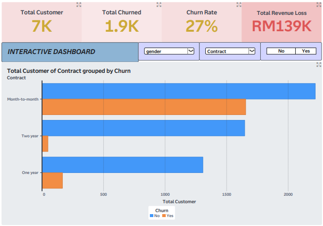
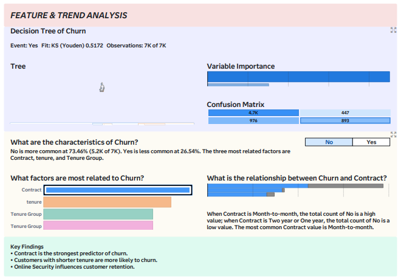
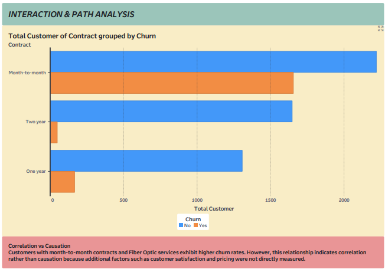
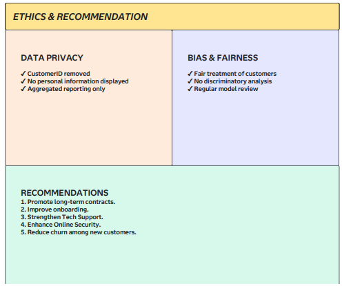

# Customer Churn Exploratory Data Analysis & Predictive Modeling (SAS Viya)

An Exploratory Data Analysis (EDA) and Decision Tree classification dashboard developed in **SAS Visual Analytics (SAS Viya)**[cite: 1, 2, 4]. This project analyzes customer attrition across **7,043 customer records**, identifies key churn drivers, quantifies monthly revenue loss, and outlines actionable retention strategies[cite: 4, 6, 7, 8].

> **Note:** Because live SAS Viya reports require authenticated server access, full-resolution dashboard views and the complete exported report (including Decision Tree statistics and Automated Explanation tables) are provided below[cite: 2, 3].

📄 **[View Full Exported Report (PDF)](Telco%20Churn%20Dashboard.pdf**)

---

## 📊 Dashboard Walkthrough

### 1. Executive KPI & Interactive Overview

*Summary KPIs (**7K** Total Customers, **1.9K** Churned, **27%** Churn Rate, **RM139K** Total Revenue Loss) with interactive `gender`, `Contract`, and `Churn` controls[cite: 6, 30].*

### 2. Feature & Trend Analysis (Decision Tree & Automated Explanation)

*Decision Tree model (`KS (Youden) = 0.5172`), Variable Importance, Confusion Matrix, and Automated Explanation identifying `Contract`, `tenure`, and `Tenure Group` as the top churn-related factors[cite: 4, 28].*

### 3. Interaction & Path Analysis

*Contract breakdown (`Month-to-month` vs. `One year` and `Two year`) grouped by churn status, paired with correlation vs. causation considerations for Fiber Optic and contract length[cite: 5, 29].*

### 4. Ethics, Governance & Recommendations

*Data privacy safeguards (`CustomerID` removed, aggregated reporting only), bias & fairness checks, and five core retention recommendations[cite: 7, 31].*

---

## 🔍 Key Metrics & Model Performance

* **Dataset & Attrition:** **7,043** total observations (**5,174** retained / `73.46%` vs. **1,869** churned / `26.54%`)[cite: 8, 23, 24, 25].
* **Revenue Impact:** **RM139,130.85** (`RM139K`) in total monthly revenue loss from churned customers[cite: 6, 26, 30].
* **Contract Breakdown:**
  * **Month-to-month:** `2,220` retained vs. `1,655` churned (`42.71%` churn)[cite: 8, 22]
  * **One year:** `1,307` retained vs. `166` churned (`11.27%` churn)[cite: 22]
  * **Two year:** `1,647` retained vs. `48` churned (`2.83%` churn)[cite: 22]
* **Decision Tree Evaluation (`Churn = Yes`):**
  * **Top Predictors (Importance):** `Contract` (`450.65`), `tenure` (`151.18`), `InternetService` (`133.58`), `TechSupport` (`27.11`), and `OnlineSecurity` (`3.95`)[cite: 10]
  * **C Statistic (ROC AUC):** `0.815`[cite: 16]
  * **KS (Youden) Statistic:** `0.5172` (optimal cutoff `0.19`: `78.76%` sensitivity, `72.96%` specificity)[cite: 4, 14, 16]
  * **Accuracy (at `0.50` cutoff):** `79.80%` (`4,727` TN, `893` TP, `447` FP, `976` FN)[cite: 11, 14, 15]
  * **Top-5% Lift:** `3.01x` baseline response rate[cite: 12, 17]

---

## 💡 Strategic Recommendations

1. **Promote Long-Term Contracts:** Incentivize month-to-month customers to migrate to one- or two-year plans[cite: 7, 31].
2. **Improve Early Onboarding:** Proactively support new customers during their first 2–6 months of tenure[cite: 7, 9, 31].
3. **Strengthen Tech Support & Online Security:** Bundle value-added protection and support services, especially for Fiber Optic users[cite: 5, 7, 9, 31].
4. **Reduce New-Customer Churn:** Monitor early-tenure risk segments identified by the Decision Tree rules[cite: 7, 9, 31].

---

## 🛠️ Tools Used

* **SAS Viya / SAS Visual Analytics** — Automated Explanation, Decision Tree Classification, Model Assessment (ROC, Lift, KS), and Interactive Dashboarding[cite: 2, 4, 6, 17].
